<div align="center">

  <!-- ═══════════════════════════════════════════════════════════════════
       ██████╗ ██████╗ ███████╗██╗  ██╗ █████╗ ██████╗ ██████╗
      ██╔═══██╗██╔══██╗██╔════╝██║  ██║██╔══██╗██╔══██╗██╔══██╗
      ██║   ██║██████╔╝███████╗███████║███████║██████╔╝██████╔╝
      ██║   ██║██╔═══╝ ╚════██║██╔══██║██╔══██║██╔══██╗██╔═══╝
      ╚██████╔╝██║     ███████║██║  ██║██║  ██║██║  ██║██║
       ╚═════╝ ╚═╝     ╚══════╝╚═╝  ╚═╝╚═╝  ╚═╝╚═╝  ╚═╝╚═╝

       SaaS-Grade Profile • 3D Animated • Gen-Z Engineered
       ═══════════════════════════════════════════════════════════════════ -->

  <!-- ▸ ANIMATED 3D HEADER BANNER ◂ -->
  <a href="https://github.com/OPSHARP">
    
  </a>

  <br/>

  <!-- ▸ ANIMATED TYPING TAGLINE — SaaS hero subtitle ◂ -->
  <a href="https://github.com/OPSHARP">
    
  </a>

  <br/>

  <!-- ▸ SaaS METRIC PILLS — Investor-deck style KPIs ◂ -->
  <p>
    
    &nbsp;
    
    &nbsp;
    
    &nbsp;
    
    &nbsp;
    
  </p>

  <!-- ▸ SOCIAL LINKS — Minimal SaaS pill row ◂ -->
  <p>
    <a href="mailto:tarunvip934@gmail.com?subject=Project%20Inquiry%20via%20GitHub"></a>
    &nbsp;
    <a href="https://play.google.com/store/apps/dev?id=4787166422555400493" target="_blank"></a>
    &nbsp;
    <a href="https://youtube.com/@tarun_ent" target="_blank"></a>
    &nbsp;
    <a href="https://instagram.com/tarun_ent" target="_blank"></a>
    &nbsp;
    <a href="https://github.com/OPSHARP" target="_blank"></a>
  </p>

</div>

<!-- ═══════════════════════════════════════════════════════════ -->


<!-- ▸ ABOUT — SaaS Product Page "What is it?" section ◂ -->

<table>
<tr>
<td width="60%" valign="top">

###  &nbsp;`sys.about()`

```js
const opsharp = {
    name       : "Tarun",
    handle     : "@OPSHARP",
    age        : 25,
    role       : "Full-Stack & Mobile Engineer",
    playStore  : "27+ Production Apps & Games",
    philosophy : "Clean Architecture • Zero Bloat • Ship Fast",
    stack      : {
        mobile   : ["Flutter", "Dart", "Kotlin", "Swift"],
        frontend : ["React", "Next.js", "Vite", "Tailwind CSS"],
        backend  : ["Node.js", "Express", "FastAPI", "Python"],
        database : ["Supabase", "Firebase", "PostgreSQL", "MongoDB"],
        ai       : ["ML Kit", "TensorFlow Lite", "On-Device NLP"],
        devops   : ["Docker", "GitHub Actions", "AWS", "Vercel"]
    },
    available  : true,   // ● OPEN FOR CONTRACTS
    rates      : "$15–$25/hr or Fixed-Scope Milestones"
};
```

</td>
<td width="40%" align="center" valign="middle">


<br/><br/>

<a href="mailto:tarunvip934@gmail.com?subject=Freelance%20Project%20Inquiry">
  
</a>

</td>
</tr>
</table>

<!-- ═══════════════════════════════════════════════════════════ -->


<!-- ▸ TECH STACK — SaaS Feature Grid ◂ -->

<div align="center">

###  &nbsp;Tech Arsenal

<table>
<tr>
<td align="center" width="25%">

<br/>
<sub><b>📱 Mobile</b></sub>

</td>
<td align="center" width="25%">

<br/>
<sub><b>🌐 Frontend</b></sub>

</td>
<td align="center" width="25%">

<br/>
<sub><b>⚙️ Backend</b></sub>

</td>
<td align="center" width="25%">

<br/>
<sub><b>🗄️ Data</b></sub>

</td>
</tr>
<tr>
<td align="center" width="25%">

<br/>
<sub><b>☁️ Cloud</b></sub>

</td>
<td align="center" width="25%">

<br/>
<sub><b>🤖 AI / ML</b></sub>

</td>
<td align="center" width="25%">

<br/>
<sub><b>🎨 Design</b></sub>

</td>
<td align="center" width="25%">

<br/>
<sub><b>🔧 Tools</b></sub>

</td>
</tr>
</table>

</div>

<!-- ═══════════════════════════════════════════════════════════ -->


<!-- ▸ FLAGSHIP PROJECTS — SaaS Product Cards ◂ -->

<div align="center">

###  &nbsp;Flagship Products

</div>

<table>
<tr>

<!-- Card 1 -->
<td width="50%" valign="top">

<div align="center">


<br/>
<b>Try On Clothes AI</b>
<br/>
<sub>AI Virtual Fitting Room</sub>

</div>

<br/>

> 🔬 Proprietary cosine alpha-blending for **100% face identity lock**
> Multi-provider AI (IDM-VTON • Replicate • Fal.ai) with in-app coin economy

<p align="center">
  <a href="https://github.com/OPSHARP/try-on-clothes-ai"></a>
  
  
</p>

</td>

<!-- Card 2 -->
<td width="50%" valign="top">

<div align="center">


<br/>
<b>PrivaScan AI</b>
<br/>
<sub>Privacy-First Document Scanner & OCR</sub>

</div>

<br/>

> 🛡️ **100% on-device** ML Kit text extraction
> Offline neural translation in 50+ languages & local summarizer. Zero cloud uploads.

<p align="center">
  <a href="https://github.com/OPSHARP/privascan_ai"></a>
  <a href="https://play.google.com/store/apps/details?id=com.privascan.ai"></a>
  
</p>

</td>
</tr>
<tr>

<!-- Card 3 -->
<td width="50%" valign="top">

<div align="center">


<br/>
<b>KRIDO</b>
<br/>
<sub>28+ Offline Kids Learning Games</sub>

</div>

<br/>

> 🎮 COPPA-compliant, ad-safe Flutter app teaching math, phonics, tracing & logic
> Built with Riverpod & zero-latency audio engine

<p align="center">
  <a href="https://github.com/OPSHARP/KRIDO"></a>
  <a href="https://play.google.com/store/apps/details?id=com.krido.kidsapp"></a>
  
</p>

</td>

<!-- Card 4 -->
<td width="50%" valign="top">

<div align="center">


<br/>
<b>YouPI Payment Gateway</b>
<br/>
<sub>Zero-Fee UPI & COD Engine</sub>

</div>

<br/>

> 💳 Universal drop-in JS checkout, instant dynamic QR payments
> WhatsApp OTP verification & webhook automation

<p align="center">
  <a href="https://github.com/OPSHARP/YouPI-PG"></a>
  
  
</p>

</td>
</tr>
<tr>

<!-- Card 5 -->
<td width="50%" valign="top">

<div align="center">


<br/>
<b>OmniRoute</b>
<br/>
<sub>Unified AI Gateway</sub>

</div>

<br/>

> ⚡ **375 providers • 1,400+ models** — One endpoint
> Token compression saving 15–95% API costs with intelligent auto-fallback

<p align="center">
  <a href="https://github.com/OPSHARP/OmniRoute"></a>
  
  
</p>

</td>

<!-- Card 6 -->
<td width="50%" valign="top">

<div align="center">


<br/>
<b>NectarLink / SharpLink</b>
<br/>
<sub>Phone-to-PC Mirroring Suite</sub>

</div>

<br/>

> 📡 DirectShow Virtual Camera, multi-track audio, AI background removal
> Seamless cable-to-WiFi handoff & zero-click mDNS discovery

<p align="center">
  <a href="https://github.com/OPSHARP/strix"></a>
  
  
</p>

</td>
</tr>
</table>

<!-- ═══════════════════════════════════════════════════════════ -->


<!-- ▸ MORE OPEN SOURCE — Compact grid ◂ -->

<div align="center">

###  &nbsp;Open Source Arsenal

<a href="https://github.com/OPSHARP/free-for-dev"></a>
&nbsp;
<a href="https://github.com/OPSHARP/agentic-awesome-skills"></a>
<br/>
<a href="https://github.com/OPSHARP/ponytail"></a>
&nbsp;
<a href="https://github.com/OPSHARP/unslop"></a>

</div>

<!-- ═══════════════════════════════════════════════════════════ -->


<!-- ▸ ACTIVITY GRAPH — Full-width animated contribution snake ◂ -->

<div align="center">

###  &nbsp;Contribution Graph

<picture>
  <source media="(prefers-color-scheme: dark)" srcset="https://raw.githubusercontent.com/OPSHARP/OPSHARP/output/github-snake-dark.svg" />
  <source media="(prefers-color-scheme: light)" srcset="https://raw.githubusercontent.com/OPSHARP/OPSHARP/output/github-snake.svg" />
  
</picture>

</div>

<!-- ═══════════════════════════════════════════════════════════ -->


<!-- ▸ STATS — Clean SaaS Analytics Dashboard ◂ -->

<div align="center">

###  &nbsp;Analytics Dashboard

<table>
<tr>
<td width="50%" align="center">


</td>
<td width="50%" align="center">


</td>
</tr>
</table>


<br/><br/>

<!-- ▸ CONTRIBUTION HEATMAP ◂ -->
<a href="https://github.com/OPSHARP">
  
</a>

</div>

<!-- ═══════════════════════════════════════════════════════════ -->


<!-- ▸ METRICS — 3D Isometric Trophies ◂ -->

<div align="center">

###  &nbsp;Achievements


</div>

<!-- ═══════════════════════════════════════════════════════════ -->


<!-- ▸ CTA FOOTER — SaaS Landing Page Style ◂ -->

<div align="center">


<br/>

### Let's Build Something Legendary

**Have a startup MVP, contract, or open-source idea? Let's ship it.**

<br/>

<a href="mailto:tarunvip934@gmail.com?subject=Project%20Inquiry%20via%20GitHub">
  
</a>
&nbsp;&nbsp;
<a href="https://play.google.com/store/apps/dev?id=4787166422555400493" target="_blank">
  
</a>
&nbsp;&nbsp;
<a href="https://youtube.com/@tarun_ent" target="_blank">
  
</a>
&nbsp;&nbsp;
<a href="https://instagram.com/tarun_ent" target="_blank">
  
</a>

<br/><br/>

<sub>

⚡ Designed & engineered by **[@OPSHARP](https://github.com/OPSHARP)** — zero bloat, max performance

</sub>

<br/>


</div>
