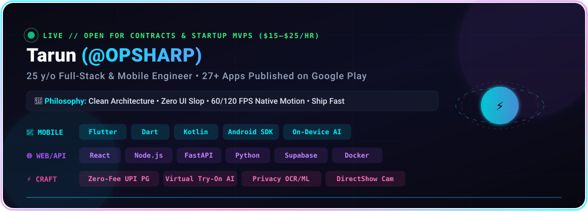
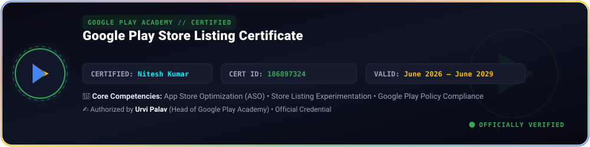
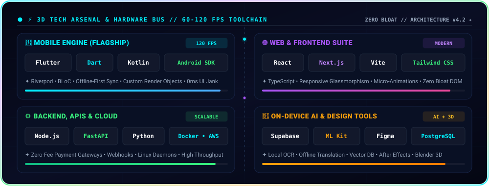
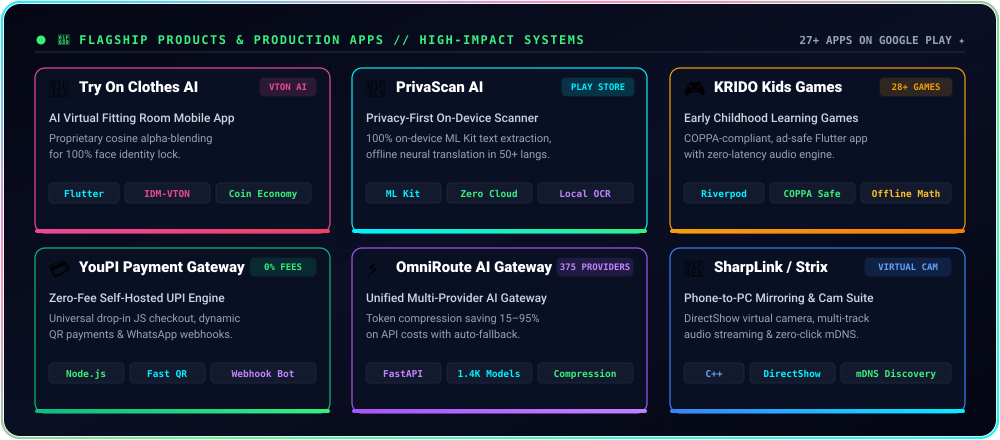

  <!-- ═══════════════════════════════════════════════════════════════════
       ✦ OPSHARP // MOTION GRAPHICS & SAAS PROFILE ✦
       ═══════════════════════════════════════════════════════════════════ -->

  <!-- ▸ ANIMATED 3D HEADER BANNER ◂ -->
  

   

  <!-- ▸ ANIMATED TYPING TAGLINE ◂ -->
  

   

  <!-- ▸ SAAS LIVE STATUS & KPI PILLS ◂ -->
  

    
    &nbsp;
    
    &nbsp;
    
    &nbsp;
    
  

  <!-- ▸ SOCIAL QUICK ACCESS ◂ -->
  

    
    &nbsp;
    
    &nbsp;
    
    &nbsp;
    
  

---

<!-- ═══════════════════════════════════════════════════════════════════
     ✦ ABOUT ME — 3D MOTION GRAPHIC PROFILE CARD ✦
     ═══════════════════════════════════════════════════════════════════ -->

###  &nbsp;About Me // Motion Profile

  

 

#### ⚡ Who I Am & What I Build
- 👨‍💻 **Tarun (@OPSHARP)** — 25-year-old Full-Stack & Mobile Engineer focused on shipping high-performance software with zero fluff.
- 📱 **Google Play Portfolio**: Built & published **[27+ production Android apps & games](https://play.google.com/store/apps/dev?id=4787166422555400493)** with smooth 60/120 FPS animations, clean architectures (BLoC/Riverpod), and offline-first data sync.
- 🤖 **On-Device AI & Vision**: Local neural translation, ML Kit text recognition, on-device OCR, and real-time virtual try-on pipelines without costly cloud lock-in.
- 💳 **Fintech & Web Engines**: Shipped zero-fee UPI payment gateways with drop-in JS checkout, dynamic QR code generators, and instant WhatsApp webhook automations.
- 💼 **Open for Work**: Available for high-impact contracts, startup MVPs, and long-term freelance collaborations (`$15–$25/hr` or milestone-based).
- 🎯 **Engineering Creed**: *Clean architecture • Zero UI slop • 60/120 FPS performance • Ship fast.*

---

<!-- ═══════════════════════════════════════════════════════════════════
     ✦ GOOGLE PLAY ACADEMY CERTIFIED // STORE LISTING SPECIALIST ✦
     ═══════════════════════════════════════════════════════════════════ -->

###  &nbsp;Google Play Academy Certified // Store Listing Specialist

  

 

| Credential Parameter | Verified Certification Details |
| :--- | :--- |
| **Certification Name** | **Google Play Store Listing Certificate** |
| **Certified Professional** | **Nitesh Kumar** |
| **Issuing Authority** | **Google Play Academy** (Authorized by Urvi Palav, Head of Academy) |
| **Certificate Number** | **`186897324`** |
| **Issue Date** | June 30, 2026 |
| **Validity Period** | **June 30, 2026 – June 30, 2029 (Active)** |
| **Specialized Skills** | App Store Optimization (ASO), Custom Store Listings, Policy Compliance & Conversion Rate |
| **Google Play Portfolio** | **[27+ Published Production Apps & Games ↗](https://play.google.com/store/apps/dev?id=4787166422555400493)** |

---

<!-- ═══════════════════════════════════════════════════════════════════
     ✦ TECH ARSENAL & TOOLCHAIN ✦
     ═══════════════════════════════════════════════════════════════════ -->

###  &nbsp;Tech Arsenal & Toolchain

  

 

| Domain | Stack & Technologies |
| :--- | :--- |
| **📱 Mobile & Native** |  |
| **🌐 Web & Frontend** |  |
| **⚙️ Backend & Cloud** |  |
| **🗄️ Database & Storage** |  |
| **🤖 AI / ML & Vision** |  |
| **🎨 Design & Motion** |  |
| **🔧 Dev Tools & CI/CD** |  |

---

<!-- ═══════════════════════════════════════════════════════════════════
     ✦ FLAGSHIP PRODUCTS SHOWCASE ✦
     ═══════════════════════════════════════════════════════════════════ -->

###  &nbsp;Flagship Products & Production Apps

  

 

#### 👗 [Try On Clothes AI](https://github.com/OPSHARP/try-on-clothes-ai)
> **AI Virtual Fitting Room Mobile App** — Proprietary cosine alpha-blending ensures 100% face identity lock. Multi-provider AI (IDM-VTON, Replicate, Fal.ai) with in-app coin economy.  
> 
> 
> 

---

#### 📄 [PrivaScan AI](https://github.com/OPSHARP/privascan_ai)
> **Privacy-First On-Device Document Scanner & OCR** — 100% on-device ML Kit text extraction, offline neural translation in 50+ languages & local summarizer. Zero cloud uploads.  
> 
> 
> 

---

#### 🎮 [KRIDO Kids Games](https://github.com/OPSHARP/KRIDO)
> **28+ Offline Early Childhood Learning Games** — COPPA-compliant, ad-safe Flutter app teaching math, phonics, tracing & logic. Built with Riverpod & zero-latency audio engine.  
> 
> 
> 

---

#### 💳 [YouPI Payment Gateway](https://github.com/OPSHARP/YouPI-PG)
> **Zero-Fee Self-Hosted UPI & COD Engine** — Universal drop-in JavaScript checkout, instant dynamic QR payments, WhatsApp OTP verification & webhook automation.  
> 
> 
> 

---

#### ⚡ [OmniRoute AI Gateway](https://github.com/OPSHARP/OmniRoute)
> **Unified Multi-Provider AI Gateway** — Single endpoint routing 375 providers & 1,400+ models. Token compression algorithms saving 15–95% on API costs with auto-fallback.  
> 
> 

---

#### 📡 [SharpLink / NectarLink](https://github.com/OPSHARP/strix)
> **Ultra-Low Latency Phone-to-PC Mirroring & Virtual Camera** — DirectShow virtual camera, isolated multi-track audio streaming, AI face beauty & background blur, and zero-click mDNS discovery.  
> 
> 
> 

---

<!-- ═══════════════════════════════════════════════════════════════════
     ✦ OPEN SOURCE ARSENAL ✦
     ═══════════════════════════════════════════════════════════════════ -->

###  &nbsp;Open Source Highlights

  

 

| Repository | Focus Area | Access |
| :--- | :--- | :---: |
| **[free-for-dev](https://github.com/OPSHARP/free-for-dev)** | Curated list of SaaS, PaaS, and IaaS software offering free developer tiers | [Browse ↗](https://github.com/OPSHARP/free-for-dev) |
| **[agentic-awesome-skills](https://github.com/OPSHARP/agentic-awesome-skills)** | Curated skills, tools, and configurations for autonomous AI coding agents | [Browse ↗](https://github.com/OPSHARP/agentic-awesome-skills) |
| **[ponytail](https://github.com/OPSHARP/ponytail)** | Autonomous agent memory, persistent logging, and context-preservation toolkit | [Browse ↗](https://github.com/OPSHARP/ponytail) |
| **[unslop](https://github.com/OPSHARP/unslop)** | AI code review and cleanup engine eliminating anti-patterns and slop | [Browse ↗](https://github.com/OPSHARP/unslop) |
| **[ArrowPuzzle](https://github.com/OPSHARP/ArrowPuzzle)** | Minimalist directional logic puzzle game with tactile haptics & 60 FPS engine | [Browse ↗](https://github.com/OPSHARP/ArrowPuzzle) |

---

<!-- ═══════════════════════════════════════════════════════════════════
     ✦ LIVE CONTRIBUTION SNAKE ✦
     ═══════════════════════════════════════════════════════════════════ -->

###  &nbsp;Live Contribution Matrix

  <picture>
    <source media="(prefers-color-scheme: dark)" srcset="https://raw.githubusercontent.com/OPSHARP/OPSHARP/output/github-snake-dark.svg" />
    <source media="(prefers-color-scheme: light)" srcset="https://raw.githubusercontent.com/OPSHARP/OPSHARP/output/github-snake.svg" />
    
  </picture>

---

<!-- ═══════════════════════════════════════════════════════════════════
     ✦ 3D ANIMATED DEVELOPER TELEMETRY & COCKPIT ✦
     ═══════════════════════════════════════════════════════════════════ -->

###  &nbsp;Developer Telemetry // 3D Animated Cockpit

  <!-- 1. 3D Animated Cockpit Dashboard -->
  

    

  <!-- 2. 3D Animated Streak & Contributions Matrix -->
  

    

  <!-- 3. 3D Animated GitHub Statistics & Programming Languages Engine -->
  

    

  <!-- 4. GitHub Contribution Heatmap -->
  

---

<!-- ═══════════════════════════════════════════════════════════════════
     ✦ GET IN TOUCH // FOOTER ✦
     ═══════════════════════════════════════════════════════════════════ -->

  

  <h3>Let's Build Something Legendary</h3>

  
<b>Have a product idea, startup MVP, or contract? Let's turn your vision into high-performance software.</b>

  

    
    &nbsp;&nbsp;
    
    &nbsp;&nbsp;
    
    &nbsp;&nbsp;
    
  

   

  ⚡ Engineered with precision by <b><a href="https://github.com/OPSHARP" style="color: #00f2fe;">@OPSHARP</a></b> • 60/120 FPS performance • Zero bloat

    

  

